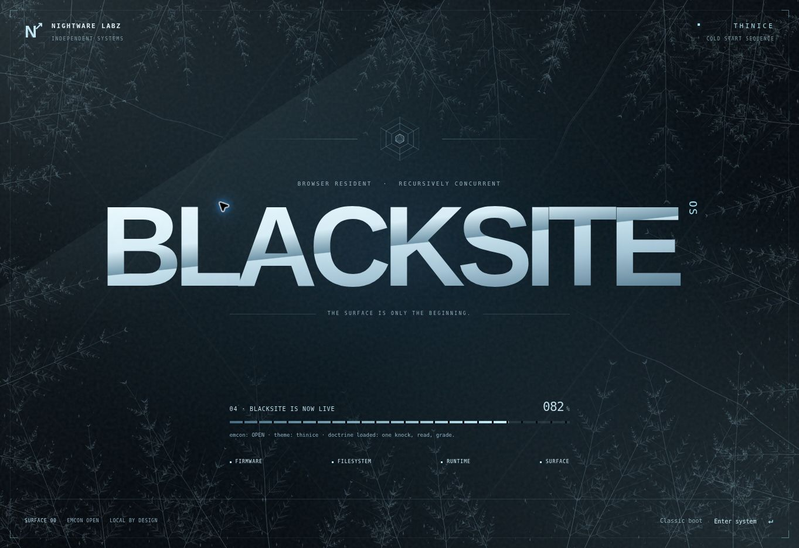
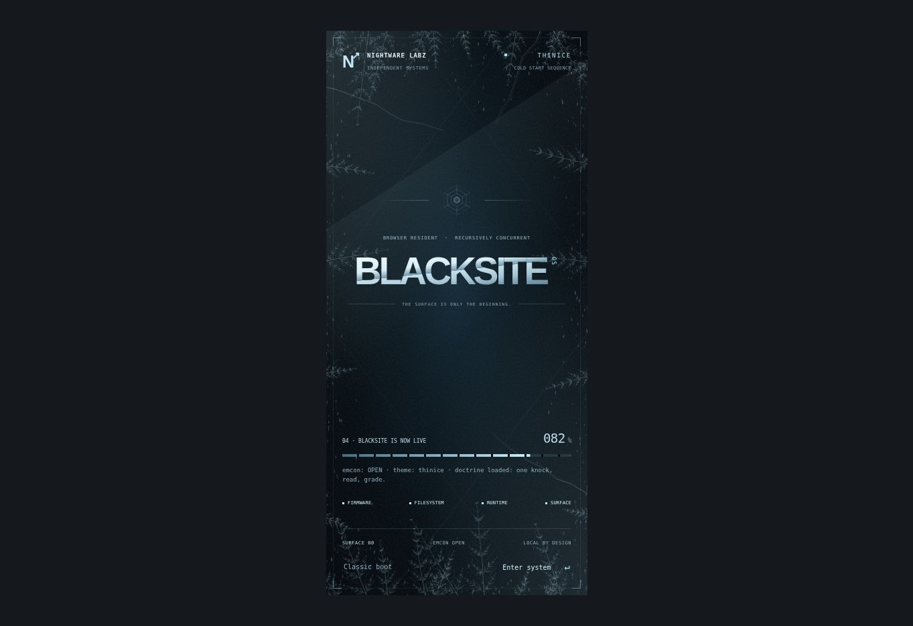

# Thinice cold start

The home page and `/blacksite/` share a cold-start screen: a machined ice wordmark, a recursive hexagonal seal, a segmented startup readout, and procedural frost that advances inward over frozen black. The desktop's solid Thinice panels stay as they are.

## Controls and fallback

- **Enter system**, **Enter**, or **Escape** skips the sequence.
- **Classic boot** immediately switches to the original nightjar badge and terminal readout and remembers that choice.
- **Settings → Boot screen** selects Thinice or the original classic screen for subsequent boots.
- `?boot=classic` and `?boot=thinice` override the saved choice for that page load. They do not write a preference.
- The classic screen also offers **Use Thinice next time**.

The original firmware lines and completion callback remain intact. Missing Canvas 2D support, incomplete effect markup, or a rendering error selects the classic readout. An independent deadline releases the overlay if the presentation stalls. This protects against effect failures after the OS script initializes; it does not replace browser-level script loading or error recovery.

## Runtime behavior

The frost is deterministic Canvas 2D geometry, cached once per size, with a reveal mask. Its backing surfaces are capped at approximately 1.5 million pixels each and a 1.5 device-pixel ratio. No image, video, font, shader, or network dependency is added. Work stops on completion or skip, and the cached surfaces are released after the exit fade.

The main sequence takes about 4.6 seconds before its exit fade. Nested instances take at most 680 milliseconds, decreasing with depth, and use the existing volatile storage namespace. Reduced-motion users see one static ice frame and enter the desktop in about 420 milliseconds, without transitions. Desktop and taskbar interaction is held only while the overlay is active; session restoration, hash launches, AEGIS and the existing sound policy stay with the OS's original completion callback.

## Verification

Run `npm run test:boot`, `npm run check`, `npm run build`, and `npm run verify`. The controller checks run in CI and cover query/preference precedence, denied storage, independent nest preferences, keyboard and repeated skips, focus return, normal completion, static reduced motion, accelerated nested boots, missing effect markup, canvas failures during creation and reveal, and the safety deadline.

Browser review covers the desktop, a 390 × 844 portrait frame, compact portrait, and landscape layouts. Review the original screen with `?boot=classic`, then select Thinice in Settings and restart. Also check a saved app session and a direct `#settings` launch. The stills below hold the actual component and frost renderer at a late startup frame so the ice can be inspected; normal startup advances automatically.

